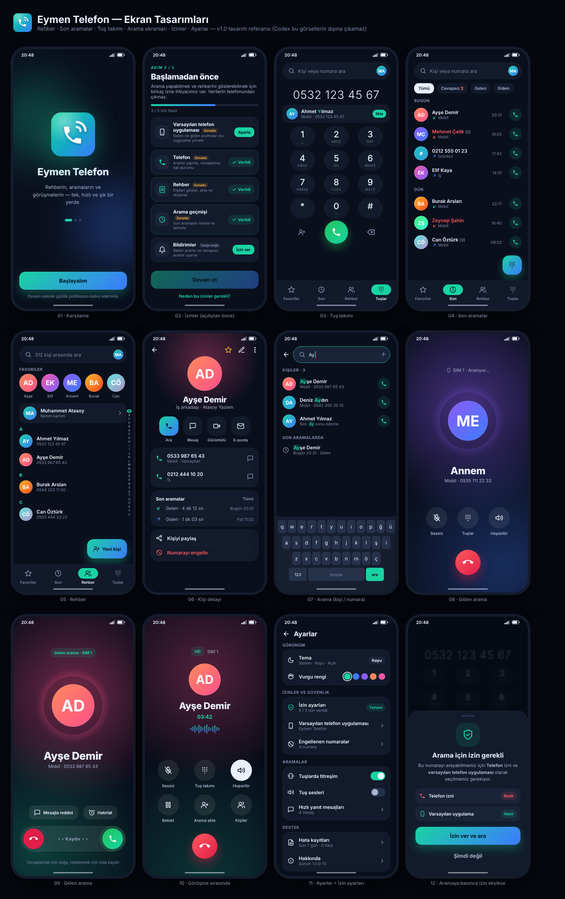

# Eymen Telefon 📞

Rehber + son aramalar + tuş takımı + kendi arama ekranları olan, varsayılan telefon uygulaması olabilen profesyonel Android uygulaması.
Tasarım ve mimari: **Claude** · Kodlama: **Codex** (kurallar: `AGENTS.md`)



## Klasör yapısı
```
EymenTelefon/
├── AGENTS.md               ← Codex kuralları (her görevden önce okunur)
├── HATA_GUNLUGU.md         ← Hatalar: önce not → düzelt → "DÜZELTİLDİ" yaz
├── docs/
│   ├── 01_TASARIM_SISTEMI.md   renk, yazı, ölçü, bileşen
│   ├── 02_EKRANLAR.md          12 ekranın davranışı
│   ├── 03_MIMARI.md            paket ağacı (✅ hazır / ⬜ Codex)
│   ├── 04_IZINLER.md           açılış öncesi izin akışı + aramaya basınca izin
│   ├── 05_GOREV_PLANI.md       14 görev, sırayla
│   └── mockups/                12 ekran PNG + genel bakış
├── design/
│   ├── icon/                   simge SVG + Play Store 512px + 1024px
│   ├── mockup_uretici.py       mockup'ları yeniden üretir
│   └── ikon_ceviri.py          ikonları Android vektörüne çevirir
├── app/                        Android projesi (Kotlin + Compose)
└── .github/workflows/apk-derle.yml   her push'ta APK + lint raporu
```

## Ekranlar
| # | Ekran | # | Ekran |
|---|---|---|---|
| 01 | Karşılama | 07 | Arama (kişi/numara) |
| 02 | İzinler (açılıştan önce) | 08 | Giden arama |
| 03 | Tuş takımı | 09 | Gelen arama (kaydırarak cevapla) |
| 04 | Son aramalar | 10 | Görüşme sırasında |
| 05 | Rehber | 11 | Ayarlar + İzin ayarları |
| 06 | Kişi detayı | 12 | Aramaya basınca izin eksik |

## Codex'e ilk mesaj (kopyala-yapıştır)
```
Bu depoda AGENTS.md dosyasını baştan sona oku ve kurallarına harfiyen uy.
Sonra HATA_GUNLUGU.md ve docs/05_GOREV_PLANI.md dosyalarını oku.
Sadece sıradaki tek görevi (GOREV-01) yap. Tasarım, renk, ölçü, paket yapısı,
kütüphane ve sürümlerde HİÇBİR değişiklik yapma. Bir hata çıkarsa önce
HATA_GUNLUGU.md'ye AÇIK olarak yaz, düzelt, sonra DÜZELTİLDİ olarak işaretle.
Görev bitince assembleDebug + lint çalıştır, kutuyu [x] yap, "GOREV-01: ..." diye commit at ve dur.
```
Sonraki görevler için aynı mesajda `GOREV-01` yerine `GOREV-02`, `GOREV-03`… yaz.

## Derleme
- Yerel: `./gradlew assembleDebug` → `app/build/outputs/apk/debug/`
- GitHub: Actions › **APK Derle** › son çalıştırma › `EymenTelefon-debug` dosyası
- Gereken: JDK 17, Android SDK 36

## Teknik özet
Kotlin 2.1 · Compose BOM 2025.05 · Material 3 · minSdk 29 (Android 10) · targetSdk 35 · compileSdk 36
`InCallService` + `RoleManager.ROLE_DIALER` · `ContactsContract` · `CallLog` · `BlockedNumberContract` · DataStore
İnternet izni yok, reklam yok, arama kaydı yok.
